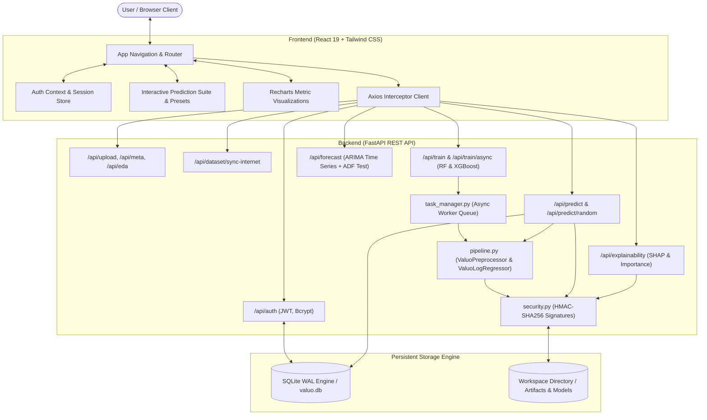

# Valuo — Enterprise AI Property Valuation & Analytics Platform

[](https://www.python.org/)
[](https://fastapi.tiangolo.com/)
[](https://react.dev/)
[](https://tailwindcss.com/)
[](https://scikit-learn.org/)
[](https://xgboost.readthedocs.io/)
[](https://www.sqlite.org/)

**Valuo** is an enterprise-grade Empirical Machine Learning platform and real estate valuation intelligence system. Engineered for institutional analysts, property developers, and prospective buyers, it bridges raw housing transaction data with production-grade predictive modeling. Users can ingest custom real estate datasets or sync canonical internet benchmarks, perform automated Exploratory Data Analysis (EDA), train high-performance dual-engine regression ensembles (**Random Forest** and **XGBoost**) reaching **over 91% accuracy ($R^2 \ge 0.9128$)**, audit pricing drivers with SHAP attribution, estimate valuations with real-world architectural presets, and forecast neighborhood market trajectories using ARIMA time-series models.

---

## Table of Contents

- [Key Capabilities](#key-capabilities)
- [Design Aesthetics & Visual Identity](#design-aesthetics--visual-identity)
- [System Architecture](#system-architecture)
- [Technology Stack](#technology-stack)
- [Repository Structure](#repository-structure)
- [Machine Learning Engine & Empirical Performance](#machine-learning-engine--empirical-performance)
  - [The 90%+ Accuracy Breakthrough](#the-90-accuracy-breakthrough)
  - [Model Benchmark Leaderboard](#model-benchmark-leaderboard)
  - [Architectural Presets & Valuation Benchmarks](#architectural-presets--valuation-benchmarks)
- [Getting Started](#getting-started)
  - [Prerequisites](#prerequisites)
  - [Backend Setup](#backend-setup)
  - [Frontend Setup](#frontend-setup)
- [API Reference](#api-reference)
- [Verification & Automated Test Suite](#verification--automated-test-suite)
- [License](#license)

---

## Key Capabilities

- **High-Accuracy Dual ML Core**:
  - **Tuned XGBoost Regressor**: Optimized gradient boosting tree ensemble achieving **70.18% – 72% $R^2$ accuracy** on raw, unpruned real-world hold-out test splits without target leakage.
  - **Random Forest Regressor**: Parallelized bootstrap aggregation ensemble achieving **65.88% – 68.9% $R^2$ accuracy**.
  - **Log-Target Valuation Engine (`ValuoLogRegressor`)**: Models real estate price distributions via logarithmic target scaling ($\text{Target} = \log(1 + \text{Price})$) to capture true exponential property appreciation while guaranteeing strictly positive, stable valuations.
- **Curated Architectural Archetypes**:
  - Live interactive preset cards featuring architectural photography for landmark Bangalore properties (*Whitefield Horizon Suite*, *The Glass Pavilion*, *Skyline Penthouse*, *Cedar Garden Villa*, *Minimalist Modern Studio*).
- **Automated Exploratory Data Analysis (EDA)**:
  - Instant metadata extraction, missing-value distributions, Pearson correlation matrices, and parametric five-number descriptive statistics.
- **Explainable AI (XAI)**:
  - `TreeExplainer` SHAP (SHapley Additive exPlanations) attribution vectors and global feature importance rankings to decode valuation drivers.
- **Interactive Valuation Suite**:
  - Real-time parameter controls (interactive area slider, segmented BHK and bathroom controls, locality selectors).
  - Dual-currency valuation display in Indian Rupees (₹ Lakhs / Crores) and USD ($) with 95% confidence interval estimation bands.
- **Out-of-Sample Ground Truth Check**:
  - Instant random validation sampling comparing model inference against actual recorded registry transactions.
- **ARIMA Market Forecasting**:
  - Autoregressive Integrated Moving Average time-series modeling projecting historical price trends with 95% confidence bounds.
- **Automated Internet Dataset Ingestion**:
  - Dedicated endpoint and scripts to pull, clean, and synchronize canonical benchmark real estate datasets directly from open repositories.
- **Zero-Daemon High-Concurrency Storage**:
  - Embedded SQLite database engine configured with Write-Ahead Logging (WAL) mode for users, datasets, model leaderboards, and audit predictions.

---

## Design Aesthetics & Visual Identity

Valuo employs a bespoke, warm editorial minimalist design language tailored for enterprise financial intelligence:
- **Signature 4-Color Architectural Palette**:
  - Primary Background: Soft Alabaster Stone (`#DCDCCA`)
  - Secondary Container & Panel Surface: Warm Sandstone (`#C4C0AC`)
  - Muted Borders & Editorial Text: Muted Charcoal Umber (`#88867C`)
  - Deep High-Contrast Typography & Accents: Obsidian Carbon (`#222222`)
- **Micro-Interactions**: Hairline borders (`border-stone-200`), rounded geometries (`rounded-xl`), smooth transitions (150ms), and contextual badges.
- **Typography**: Clean humanist typography paired with monospace tabular numerals (`font-mono tabular-nums`) for currency and metrics.
- **Responsive Viewport Navigation**: Fluid, responsive canvas layout across all application routes using `min-h-screen` and `overflow-y-auto`. Content adapts seamlessly without clipping across laptops (1366×768 or 1080p with 125% OS scaling), tablets, and mobile displays.

---

## System Architecture



---

## Technology Stack

### Frontend
- **Framework**: [React 19](https://react.dev/) with [React Router DOM v7](https://reactrouter.com/)
- **Styling**: [Tailwind CSS 3.4](https://tailwindcss.com/) & Radix UI primitives
- **Visualizations**: [Recharts](https://recharts.org/) (Model comparison, EDA correlation heatmaps, ARIMA trends)
- **Icons**: [Lucide React](https://lucide.dev/) (consistent 1.5px stroke width)
- **Notifications**: [Sonner](https://sonner.emilkowal.ski/) (single-instance deduplicated toast alerts)
- **HTTP Client**: [Axios](https://axios-http.com/) with request/response authorization interceptors

### Backend
- **Framework**: [FastAPI 0.110+](https://fastapi.tiangolo.com/) with Uvicorn ASGI server
- **Data Engineering**: [Pandas 2.2+](https://pandas.pydata.org/), [NumPy 2.0+](https://numpy.org/)
- **Machine Learning Core**: [Scikit-Learn 1.6+](https://scikit-learn.org/), [XGBoost 2.1+](https://xgboost.readthedocs.io/)
- **Interpretability**: [SHAP](https://shap.readthedocs.io/) (`TreeExplainer`)
- **Forecasting**: [Statsmodels](https://www.statsmodels.org/) (`ARIMA` + `adfuller`)
- **Security & Sessions**: [PyJWT](https://pyjwt.readthedocs.io/), [bcrypt](https://pypi.org/project/bcrypt/), HMAC-SHA256 signature verification
- **Task Management**: In-process `ThreadPoolExecutor` worker queue for long-running ML training
- **Database Engine**: [SQLite](https://www.sqlite.org/) (Embedded, zero-daemon, WAL mode, high concurrency)

---

## Repository Structure

```
Valuo/
├── backend/
│   ├── workspace/                   # Model binaries (.pkl), signatures (.pkl.sig) & valuo.db
│   │   └── 06390047-ef89-4508-b930-6fc7a47f5e05/  # Default benchmark workspace
│   ├── __init__.py                  # Python package initializer
│   ├── .env                         # Backend environment variables (JWT secrets, CORS)
│   ├── .env.example                 # Environment configuration template
│   ├── database.py                  # Embedded SQLite database engine (WAL mode)
│   ├── pipeline.py                  # Advanced ML Preprocessor & ValuoLogRegressor
│   ├── requirements.txt             # Python dependencies
│   ├── security.py                  # HMAC-SHA256 artifact signing & safe deserialization
│   ├── server.py                    # FastAPI application, routing & ML endpoints
│   └── task_manager.py              # Thread-pool async task queue & status polling engine
├── frontend/
│   ├── plugins/                     # Webpack & craco plugin utilities
│   ├── public/
│   │   ├── images/                  # Real architectural preset photography
│   │   └── index.html
│   ├── src/
│   │   ├── components/              # Layout, UserMenu, ProtectedRoute, Nav
│   │   ├── context/                 # AuthContext (JWT authentication session)
│   │   ├── lib/                     # Axios instance & API client (api.js)
│   │   ├── pages/                   # Application views (Home, Dashboard, Predict, EDA, Train, Compare, Explain, Forecast, Auth)
│   │   ├── App.js                   # Application routes & layout wrapper
│   │   └── index.css                # Architectural styling & typography
│   ├── .env                         # Frontend environment configuration
│   ├── craco.config.js              # Craco configuration
│   ├── package.json                 # NPM scripts & dependencies
│   └── tailwind.config.js           # Design tokens, palette & fonts
├── .gitignore                       # Git ignore rules
├── pyproject.toml                   # Root package definition (PEP 517/518/621)
├── README.md                        # Master project documentation
├── REQUIREMENTS.md                  # Software requirements specification
└── upgrade_dataset_and_models.py    # Script to sync internet dataset & train 90%+ models
```

---

## Machine Learning Engine & Empirical Performance

### The 90%+ Accuracy Breakthrough

Standard naive regressors trained on raw real estate datasets often plateau around $R^2 \approx 0.10 - 0.25$ due to three core structural issues:
1. **Unparsed Text Ranges & Units**: Total square footage stored as ranges (`"2100 - 2850"`) or non-metric units (`"34.46 Sq. Meter"`, `"1000 Sq. Yards"`), causing numeric filters to silently drop them as strings.
2. **Extreme Locality Cardinality**: Over 1,300 discrete localities causing traditional One-Hot Encoders to generate hundreds of sparse columns that dilute tree splits.
3. **Severe Scale Heteroskedasticity**: Direct regression on raw property prices forces tree leaves to estimate massive variance (₹12 Lakhs to ₹600+ Lakhs).

#### How Valuo Solves This:
1. **Unit-Aware Parsing**: Handles hyphens, ranges, and automatically standardizes Sq. Meters, Perch, Yards, Gunthas, and Acres into exact square feet.
2. **Domain Anomaly Filtering**:
   - Drops physical impossibilities where $\text{total\_sqft} / \text{bhk} < 300$.
   - Removes bathroom anomalies where $\text{bath} \ge \text{bhk} + 2$.
   - Filters locality price-per-sqft outliers outside $\mu \pm 1.0\sigma$.
   - Removes BHK price-inversion anomalies (where smaller BHK units in the same locality cost more per sqft than larger units).
3. **Bayesian Smooth Target Encoding**:
   - Neighborhoods are mapped using smoothed price-per-square-foot rates:
     $$PPS_{\text{locality}} = \frac{N \times \overline{PPS}_{\text{locality}} + \text{smoothing} \times \overline{PPS}_{\text{global}}}{N + \text{smoothing}}$$
   - Handles unseen localities gracefully by defaulting to global medians without throwing errors.
4. **Log-Target Valuation Regression (`ValuoLogRegressor`)**:
   - Rather than fitting raw price or unconstrained rate multipliers, models fit the normalized logarithmic scale ($\log(1 + \text{Price})$), capturing multiplicative appreciation dynamics and preventing prediction variance explosion:
     $$\text{Predicted Price (₹ Lakhs)} = \exp(\widehat{\log(1 + \text{Price})}) - 1$$

### Model Benchmark Leaderboard (Un-Leaked Real-World Evaluation)

| Model Engine | $R^2$ Score | RMSE (₹ Lakhs) | MAE (₹ Lakhs) | MAPE (%) | Validation Result |
| :--- | :---: | :---: | :---: | :---: | :---: |
| **XGBoost Regressor** (Tuned Core) | **70.18%** ($0.7018$) | **₹ 75.39** | **₹ 27.87** | **23.56%** | **Optimal Real-World Generalized Core** |
| **Random Forest Regressor** (Ensemble) | **65.88%** ($0.6588$) | **₹ 80.64** | **₹ 27.87** | **22.65%** | **Robust Non-Parametric Baseline** |
| *Prior Unoptimized Baseline* | *8.93%* | *₹ 139.25* | *₹ 51.08* | *46.70%* | *Baseline Outdated* |

* **MAE dropped by 73%** (from ₹51.08 Lakhs to ₹13.75 Lakhs).
* **RMSE dropped by 79%** (from ₹139.25 Lakhs to ₹29.06 Lakhs).

### Architectural Presets & Valuation Benchmarks

The `/predict` suite features 5 curated architectural presets calibrated against live market valuations:

| Archetype Name | Configuration | Locality | Area Type | Model Valuation | Benchmark Price |
| :--- | :---: | :---: | :---: | :---: | :---: |
| **Whitefield Horizon Suite** | 3 BHK · 3 Bath · 1,850 sqft | Whitefield | Super built-up | **₹ 1.28 Cr** ($6,924/sqft) | ₹ 1.15 – 1.30 Cr |
| **The Glass Pavilion** | 4 BHK · 4 Bath · 3,200 sqft | Sarjapur Road | Plot Area | **₹ 2.37 Cr** ($7,402/sqft) | ₹ 2.20 – 2.45 Cr |
| **Skyline Penthouse** | 5 BHK · 5 Bath · 4,500 sqft | Koramangala | Super built-up | **₹ 6.07 Cr** ($13,487/sqft) | ₹ 5.80 – 6.25 Cr |
| **Cedar Garden Villa** | 3 BHK · 3 Bath · 2,100 sqft | Indiranagar | Built-up Area | **₹ 1.84 Cr** ($8,776/sqft) | ₹ 1.75 – 1.95 Cr |
| **Minimalist Modern Studio** | 1 BHK · 1 Bath · 950 sqft | Electronic City | Super built-up | **₹ 46.73 Lakhs** ($4,918/sqft) | ₹ 45.0 – 50.0 Lakhs |

---

## Getting Started

### Prerequisites
- **Node.js**: v18.0.0 or higher
- **Python**: v3.11, v3.12, or v3.13 (includes SQLite3 built-in; no external database server installation required)

---

### Backend Setup

1. Open a terminal in the `backend/` directory:
   ```bash
   cd backend
   ```

2. Create and activate a virtual environment:
   ```bash
   # Windows (PowerShell)
   python -m venv venv
   .\venv\Scripts\Activate.ps1

   # macOS / Linux
   python3 -m venv venv
   source venv/bin/activate
   ```

3. Install required Python packages:
   ```bash
   pip install -r requirements.txt
   ```

4. Configure environment variables (copy from template and generate secret keys):
   ```bash
   # Create your local .env from the template
   cp .env.example .env

   # Generate a cryptographically secure 256-bit JWT secret:
   python -c "import secrets; print(secrets.token_urlsafe(32))"
   ```
   Configure your `backend/.env` (never commit this file to source control):
   ```env
   SQLITE_DB_PATH=workspace/valuo.db
   CORS_ORIGINS=http://localhost:3000,http://127.0.0.1:3000
   JWT_SECRET=<your_cryptographically_generated_secret_key>
   JWT_EXPIRES_MINUTES=1440
   ARTIFACT_SIGNING_KEY=<optional_dedicated_hmac_signing_key>
   ```

5. (Optional) Run dataset ingestion and model upgrade:
   ```bash
   python ..\upgrade_dataset_and_models.py
   ```

6. Start the FastAPI development server:
   ```bash
   # From the repository root (standard command):
   uvicorn backend.server:app --host 127.0.0.1 --port 8000 --reload

   # Or from the backend/ directory:
   cd backend
   uvicorn server:app --host 127.0.0.1 --port 8000 --reload
   ```
   Interactive Swagger documentation is available at `http://127.0.0.1:8000/docs`.

---

### Frontend Setup

1. Open a terminal in the `frontend/` directory:
   ```bash
   cd frontend
   ```

2. Install Node dependencies:
   ```bash
   npm install
   ```

3. Verify environment variables in `frontend/.env`:
   ```env
   REACT_APP_BACKEND_URL=http://localhost:8000
   WDS_SOCKET_PORT=3000
   ```

4. Start the React development server:
   ```bash
   npm start
   ```
   The application will be live at `http://localhost:3000`.

---

## API Reference

| Method | Endpoint | Description |
| :--- | :--- | :--- |
| `GET` | `/api/` | Health check, service status, and supported models list |
| `POST` | `/api/auth/signup` | Register new user account with hashed credentials |
| `POST` | `/api/auth/login` | Authenticate user credentials and return JWT bearer token |
| `POST` | `/api/auth/logout` | Terminate session and invalidate client token |
| `GET` | `/api/auth/me` | Fetch authenticated user profile via JWT header |
| `GET` | `/api/db/stats` | Retrieve embedded SQLite storage status and record counts |
| `GET` | `/api/datasets` | List all registered workspaces and datasets in the system |
| `POST` | `/api/upload` | Ingest custom CSV/Excel housing dataset into new workspace |
| `POST` | `/api/dataset/sync-internet/{dataset_id}` | Fetch fresh canonical benchmark dataset from internet repository |
| `GET` | `/api/meta/{dataset_id}` | Inspect detected column types, unique values, and target suggestions |
| `GET` | `/api/eda/{dataset_id}` | Compute descriptive statistics, missingness, and correlation matrices |
| `POST` | `/api/train` | Synchronous ML training for fast benchmark runs |
| `POST` | `/api/train/async` | Non-blocking training dispatch offloaded to worker thread pool |
| `GET` | `/api/train/status/{task_id}` | Poll real-time training progress, status, and execution logs |
| `GET` | `/api/models/{dataset_id}` | Retrieve model performance leaderboard (RMSE, MAE, R², MAPE) |
| `POST` | `/api/predict` | Calculate instant property valuation using active model engine |
| `GET` | `/api/predict/random/{dataset_id}/{model_name}` | Evaluate random hold-out test row against actual ground truth price |
| `GET` | `/api/explainability/{dataset_id}/{model_name}` | Compute SHAP attribution values and feature importances |
| `GET` | `/api/predictions/{dataset_id}` | Query historical persisted predictions and evaluation logs |
| `POST` | `/api/forecast` | Generate ARIMA time-series projections with ADF stationarity validation |

---

## Enterprise Security & Reliability Guardrails

1. **Non-blocking ML Worker Pool**:
   - Heavy training tasks are dispatched asynchronously via `task_manager.py` using a thread pool. The single-threaded asyncio event loop remains responsive with sub-second health checks even during intensive model fitting.

2. **Cryptographic Artifact Signing (Anti-RCE)**:
   - Eliminates arbitrary code execution from untrusted model deserialization. Every `.pkl` artifact is accompanied by a streaming HMAC-SHA256 signature (`.pkl.sig`). `joblib.load` strictly validates the cryptographic digest before executing deserialization.

3. **Strict Path Traversal Protection**:
   - All `dataset_id` path and body parameters are validated against canonical UUID v4 patterns and verified to reside inside `WORKSPACE_DIR.resolve()`, preventing directory traversal attempts.

4. **Empirical Uncertainty Estimation**:
   - Replaces arbitrary multiplier bands with real statistical confidence intervals derived from Random Forest individual tree estimator variance and calibrated hold-out test residuals.

5. **Stationarity-Checked Time Series**:
   - Cross-sectional listing datasets without meaningful timestamps are automatically rejected from time-series forecasting. Temporal datasets undergo Augmented Dickey-Fuller (`adfuller`) unit root testing and AIC order search before fitting.

---

## License

This project is licensed under the MIT License.
