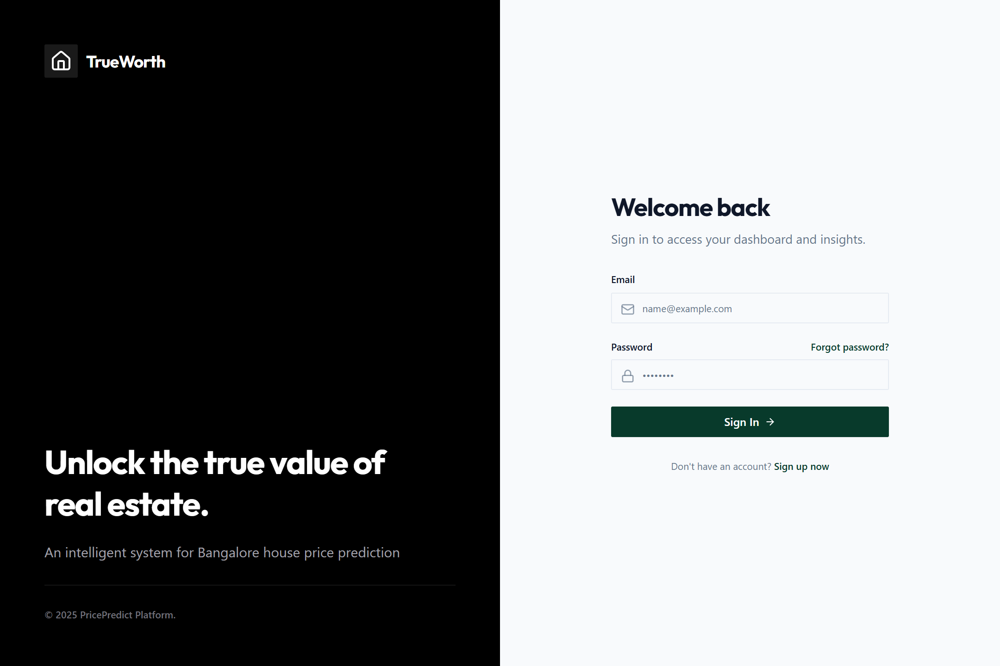
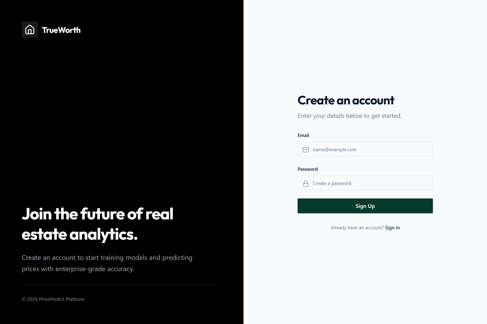
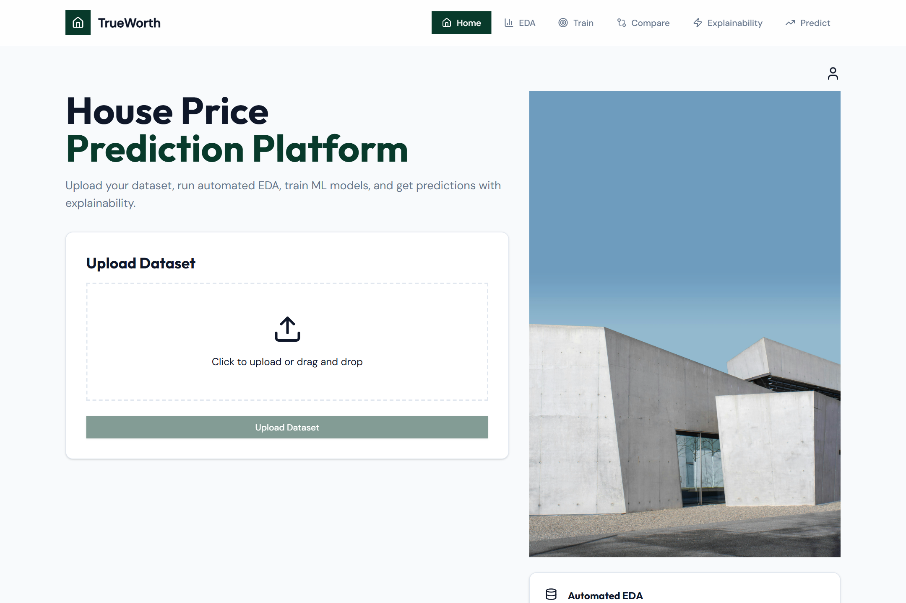
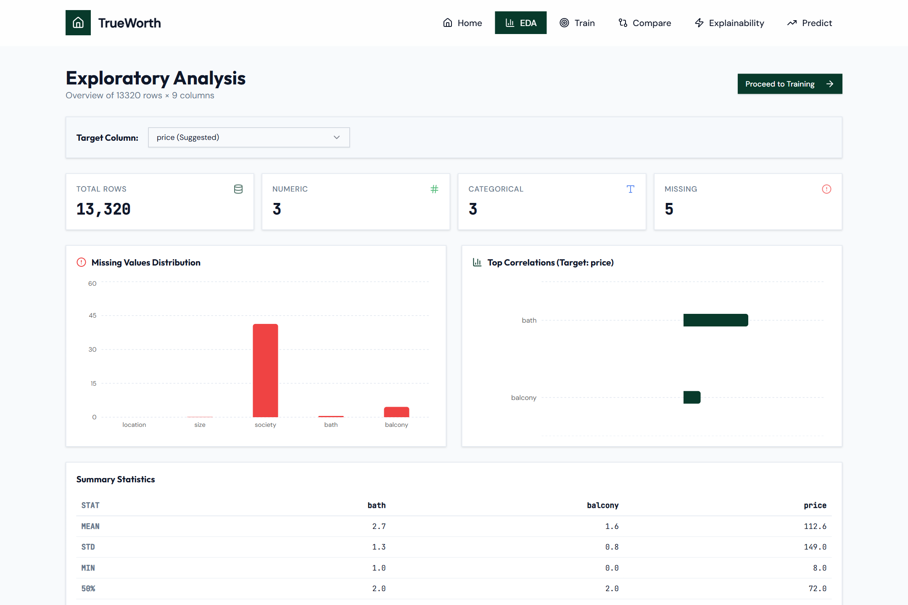
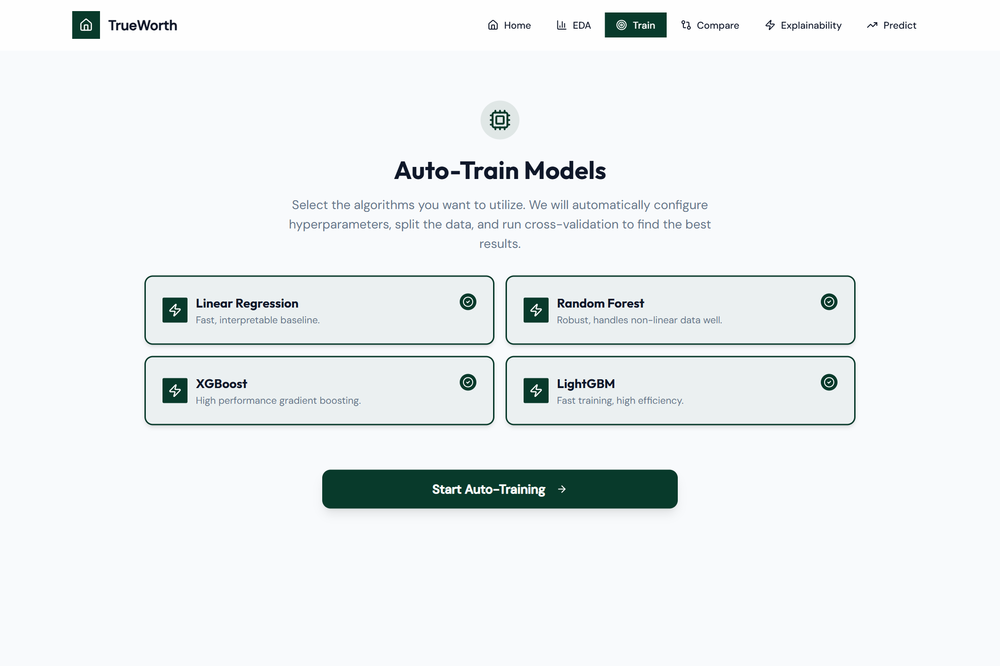
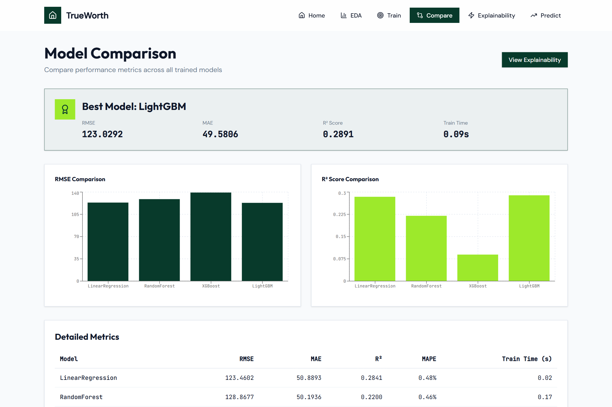
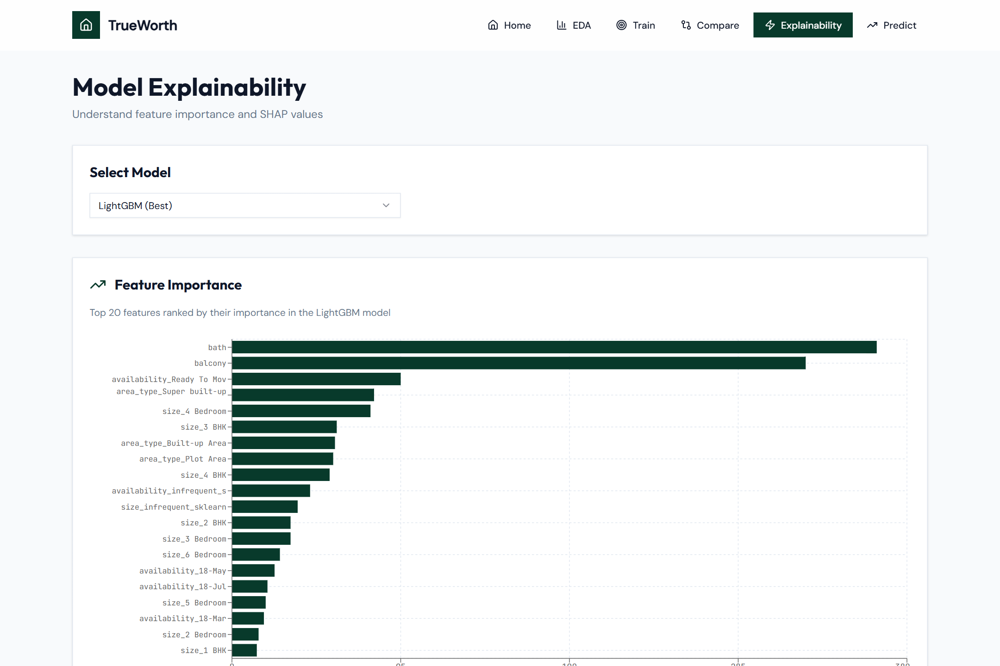
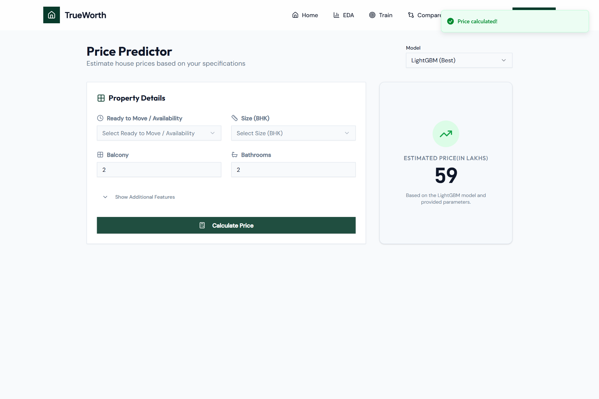
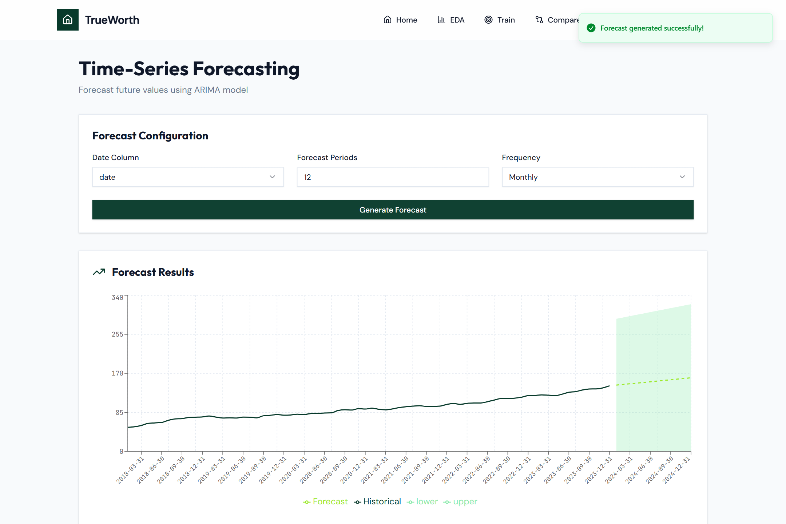

# 🏡 TrueWorth - Intelligent House Price Prediction & Analytics Platform

[](https://www.python.org/)
[](https://fastapi.tiangolo.com/)
[](https://react.dev/)
[](https://tailwindcss.com/)
[](https://scikit-learn.org/)
[](https://xgboost.readthedocs.io/)
[](https://lightgbm.readthedocs.io/)

**TrueWorth** is an end-to-end Machine Learning web application and real estate valuation platform. It enables real estate analysts, home buyers, and investors to upload custom housing datasets, run automated Exploratory Data Analysis (EDA), train and compare state-of-the-art regression models (Linear Regression, Random Forest, XGBoost, and LightGBM), interpret models with SHAP values, perform real-time price predictions, and forecast price trends using ARIMA time-series models.

---

## 📑 Table of Contents

- [Key Features](#-key-features)
- [Frontend UI Gallery](#-frontend-ui-gallery)
- [System Architecture](#-system-architecture)
- [Technology Stack](#-technology-stack)
- [Repository Structure](#-repository-structure)
- [Getting Started](#-getting-started)
  - [Prerequisites](#prerequisites)
  - [Backend Setup](#backend-setup)
  - [Frontend Setup](#frontend-setup)
- [API Reference](#-api-reference)
- [Machine Learning Pipeline](#-machine-learning-pipeline)
- [Screenshots Index](#-screenshots-index)
- [License](#-license)

---

## ✨ Key Features

- **📊 Automated Exploratory Data Analysis (EDA)**: Instant dataset profiling with row/column counts, missing values distribution, target correlation analysis, and summary statistics.
- **⚡ Automated Multi-Model Training**: Parallel training and evaluation of 4 industry-standard algorithms:
  - Linear Regression (Baseline)
  - Random Forest Regressor
  - XGBoost Regressor
  - LightGBM Regressor
- **🏆 Model Leaderboard & Comparison**: Multi-metric evaluation including **RMSE**, **MAE**, **R²**, **MAPE**, and **Training Time** with interactive comparison bar charts.
- **🔍 Explainable AI (XAI)**: SHAP (SHapley Additive exPlanations) and global feature importance rankings to decode model predictions and prevent black-box decisions.
- **🎯 Interactive Real-Time Prediction**: Property specification inputs with automated fallback and imputation for partial features, displaying instant valuation estimates in Lakhs (₹).
- **📈 ARIMA Time-Series Forecasting**: Historical trend analysis and future price projection with 95% confidence intervals.
- **🎨 Modern Dark/Light Design System**: Clean typography, glassmorphism navigation, and responsive layouts built with React 19, Lucide Icons, and Recharts.

---

## 🖼️ Frontend UI Gallery

Below are high-resolution screenshots capturing each workflow in the TrueWorth user interface:

### 1. Authentication (Login & Signup)
Modern split-screen layout with branding, feature highlights, and secure authentication forms.

| Login Screen | Signup Screen |
| :---: | :---: |
|  |  |

---

### 2. Home Dashboard & Dataset Upload
Clean drag-and-drop file upload zone supporting CSV and Excel spreadsheets with platform capability highlights.



---

### 3. Automated Exploratory Data Analysis (EDA)
Comprehensive dataset overview featuring missing value distributions, top target correlations, and summary statistics.



---

### 4. Multi-Model Training Interface
One-click multi-model training configuration for Linear Regression, Random Forest, XGBoost, and LightGBM with customizable test split sizes.



---

### 5. Model Comparison & Metrics Leaderboard
Side-by-side performance evaluation displaying best-model selection, RMSE/R² visual charts, and detailed evaluation metrics.



---

### 6. Model Explainability & SHAP Feature Importance
Interactive feature importance charts demonstrating which property attributes (e.g., bathrooms, balconies, square footage) drive valuations.



---

### 7. Interactive Real-Time Price Prediction
Input property attributes to calculate instant valuations with automated feature imputation and clear price breakdown.



---

### 8. Time-Series Market Forecasting
ARIMA modeling with historical trajectory, future projection curve, and 95% upper/lower confidence bounds.



---

## 🏗️ System Architecture

```mermaid
flowchart TD
    User([User / Browser])
    
    subgraph Frontend ["Frontend (React 19 + Tailwind CSS)"]
        UI[App Router & Pages]
        State[Local & React State]
        Charts[Recharts Visualizations]
    end

    subgraph Backend ["Backend (FastAPI REST API)"]
        Router[API Endpoints]
        Preproc[Data Preprocessing & RobustScaler]
        Trainer[Model Training Engine]
        XAI[SHAP & Feature Importance]
        Forecaster[ARIMA Time-Series Engine]
    end

    subgraph Storage ["Storage & Workspace"]
        FS[(Local Workspace / Disk)]
        DB[(MongoDB Database)]
    end

    User <--> UI
    UI --> Router
    Router --> Preproc
    Preproc --> Trainer
    Trainer --> FS
    Trainer --> XAI
    Router --> Forecaster
    Router <--> DB
    Charts <--> UI
```



---

## 💻 Technology Stack

### Frontend
- **Framework**: [React 19](https://react.dev/) with React Router DOM v7
- **Styling**: [Tailwind CSS](https://tailwindcss.com/) & Radix UI primitives
- **Data Visualization**: [Recharts](https://recharts.org/)
- **Icons**: [Lucide React](https://lucide.dev/)
- **Toasts**: [Sonner](https://sonner.emilkowal.ski/)
- **HTTP Client**: [Axios](https://axios-http.com/)

### Backend
- **Framework**: [FastAPI](https://fastapi.tiangolo.com/) with Uvicorn ASGI server
- **Data Manipulation**: [Pandas](https://pandas.pydata.org/), [NumPy](https://numpy.org/)
- **Machine Learning**: [Scikit-Learn](https://scikit-learn.org/), [XGBoost](https://xgboost.readthedocs.io/), [LightGBM](https://lightgbm.readthedocs.io/)
- **Explainability**: [SHAP](https://shap.readthedocs.io/)
- **Forecasting**: [Statsmodels (ARIMA)](https://www.statsmodels.org/)
- **Database**: [Motor](https://motor.readthedocs.io/) (Async MongoDB driver)

---

## 📂 Repository Structure

```
HousePP/
├── backend/
│   ├── .env                     # Backend configuration (MongoDB, CORS)
│   ├── requirements.txt         # Python dependencies
│   ├── server.py                # FastAPI application & ML pipelines
│   └── workspace/               # Stored datasets, trained models, & metadata
├── frontend/
│   ├── .env                     # Frontend configuration (API URL)
│   ├── package.json             # NPM dependencies & scripts
│   ├── tailwind.config.js       # Tailwind CSS configuration
│   ├── public/                  # Static assets & index.html
│   └── src/
│       ├── assets/              # Images and graphics
│       ├── components/          # Reusable UI components (Layout, Cards, Dialogs)
│       └── pages/               # Application views
│           ├── HomePage.jsx     # Dataset upload & dashboard
│           ├── EDAPage.jsx      # Exploratory data analysis
│           ├── TrainPage.jsx    # Model training interface
│           ├── ComparePage.jsx  # Model comparison leaderboard
│           ├── ExplainabilityPage.jsx # SHAP & Feature importance
│           ├── PredictPage.jsx  # Property price calculator
│           ├── ForecastPage.jsx # ARIMA time-series forecasting
│           └── auth/            # Login & Signup pages
├── screenshots/                 # UI screenshots for documentation
│   ├── 01_login_page.png
│   ├── 02_signup_page.png
│   ├── 03_home_dashboard.png
│   ├── 04_eda_dashboard.png
│   ├── 05_model_training.png
│   ├── 06_model_comparison.png
│   ├── 07_explainability_shap.png
│   ├── 08_price_prediction.png
│   └── 09_timeseries_forecast.png
├── capture_screenshots.js       # Automated Puppeteer screenshot script
└── README.md                    # Project documentation
```

---

## 🚀 Getting Started

### Prerequisites
- **Node.js**: v18.0.0 or higher
- **Python**: v3.11, v3.12, or v3.13
- **MongoDB** *(Optional)*: Local or cloud instance (e.g. MongoDB Atlas)

---

### Backend Setup

1. Open a terminal in the `backend/` directory:
   ```bash
   cd backend
   ```

2. Create and activate a virtual environment:
   ```bash
   # Windows (PowerShell)
   python -m venv venv
   .\venv\Scripts\Activate.ps1

   # macOS / Linux
   python3 -m venv venv
   source venv/bin/activate
   ```

3. Install required Python packages:
   ```bash
   pip install -r requirements.txt
   pip install lightgbm shap
   ```

4. Configure environment variables in `backend/.env`:
   ```env
   MONGO_URL=mongodb://localhost:27017
   DB_NAME=trueworth_db
   CORS_ORIGINS=http://localhost:3000
   ```

5. Start the FastAPI development server:
   ```bash
   uvicorn server:app --host 127.0.0.1 --port 8000 --reload
   ```
   The backend API will be accessible at `http://127.0.0.1:8000`. API documentation is available at `http://127.0.0.1:8000/docs`.

---

### Frontend Setup

1. Open a new terminal in the `frontend/` directory:
   ```bash
   cd frontend
   ```

2. Install Node dependencies:
   ```bash
   npm install
   ```

3. Verify environment variables in `frontend/.env`:
   ```env
   REACT_APP_BACKEND_URL=http://localhost:8000
   WDS_SOCKET_PORT=3000
   ```

4. Start the React development server:
   ```bash
   npm start
   ```
   The web application will open automatically in your browser at `http://localhost:3000`.

---

## 🔌 API Reference

| Method | Endpoint | Description |
| :--- | :--- | :--- |
| `GET` | `/api/` | Health check & service status |
| `POST` | `/api/upload` | Upload CSV/Excel dataset and initialize workspace |
| `GET` | `/api/meta/{dataset_id}` | Retrieve column types, sample values, and suggested targets |
| `GET` | `/api/eda/{dataset_id}` | Compute summary statistics, missing values, and target correlations |
| `POST` | `/api/train` | Train specified models (`LinearRegression`, `RandomForest`, `XGBoost`, `LightGBM`) |
| `GET` | `/api/models/{dataset_id}` | Fetch evaluation metrics and leaderboard for trained models |
| `POST` | `/api/predict` | Predict property price for custom input parameters |
| `GET` | `/api/predict/random/{dataset_id}/{model_name}` | Fetch a random test row and compare prediction against actual price |
| `GET` | `/api/explainability/{dataset_id}/{model_name}` | Retrieve SHAP values and feature importance weights |
| `POST` | `/api/forecast` | Generate ARIMA time-series forecast with confidence intervals |

---

## ⚙️ Machine Learning Pipeline

1. **Type Detection**: Automatic classification of features into numeric, categorical, and datetime columns.
2. **Missing Value Imputation**:
   - Numeric features: Median imputation via `SimpleImputer(strategy='median')`.
   - Categorical features: Most frequent imputation via `SimpleImputer(strategy='most_frequent')`.
3. **Feature Scaling & Encoding**:
   - Numeric: `RobustScaler()` to resist property outlier prices.
   - Categorical: `OneHotEncoder(handle_unknown='ignore', max_categories=10)`.
4. **Model Training & Cross-Validation**:
   - Models are fitted against the transformed training set and evaluated on the held-out test split.
5. **Persistence**:
   - Preprocessing pipelines (`preprocessor.pkl`), feature maps (`feature_names.json`), and trained models (`model_*.pkl`) are versioned by `dataset_id`.

---

## 📷 Screenshots Index

All screenshots captured from the live application are located in the [`screenshots/`](screenshots/) directory:

- [`screenshots/01_login_page.png`](screenshots/01_login_page.png) - User Authentication Login Screen
- [`screenshots/02_signup_page.png`](screenshots/02_signup_page.png) - User Registration Screen
- [`screenshots/03_home_dashboard.png`](screenshots/03_home_dashboard.png) - Home Dashboard & Dataset Uploader
- [`screenshots/04_eda_dashboard.png`](screenshots/04_eda_dashboard.png) - Exploratory Data Analysis Dashboard
- [`screenshots/05_model_training.png`](screenshots/05_model_training.png) - Auto-Train Model Configuration
- [`screenshots/06_model_comparison.png`](screenshots/06_model_comparison.png) - Model Metrics Leaderboard & Comparison
- [`screenshots/07_explainability_shap.png`](screenshots/07_explainability_shap.png) - Feature Importance & SHAP Values
- [`screenshots/08_price_prediction.png`](screenshots/08_price_prediction.png) - Interactive Price Predictor
- [`screenshots/09_timeseries_forecast.png`](screenshots/09_timeseries_forecast.png) - ARIMA Time-Series Forecasting

---

## 📄 License

This project is licensed under the MIT License.
